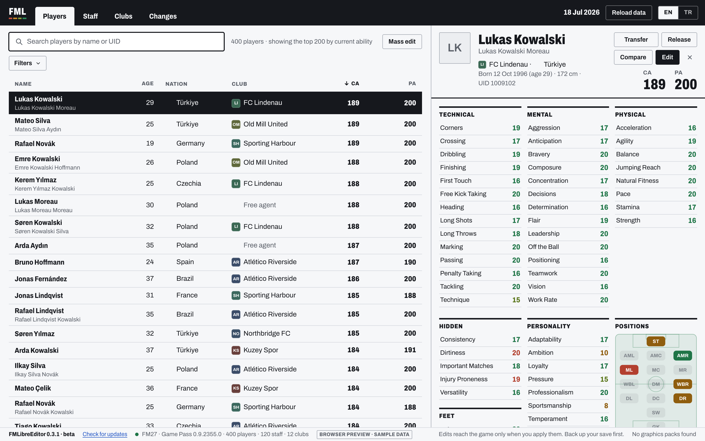
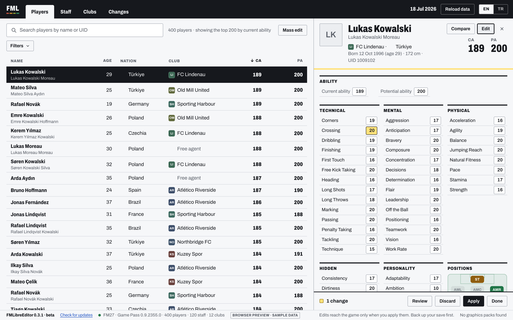

# FMLibreEditor

A free, open-source live editor for **Football Manager 27**. Edit players, staff and clubs
while the game runs.

Works on **Windows** (Xbox / Game Pass and Steam) and **macOS** (Steam).

**Open source, and open to your help:** fixes, translations, testing on your copy of the game or
findings about FM27's data are all welcome. See [Contributing](#contributing).

## Download

- **Windows 10 or 11:**
  [FMLibreEditor-Setup.exe](https://github.com/tozmoz/FMLibreEditor/releases/latest/download/FMLibreEditor-Setup.exe)
  or the [portable zip](https://github.com/tozmoz/FMLibreEditor/releases/latest/download/FMLibreEditor-portable.zip)
- **macOS:**
  [FMLibreEditor-macOS.zip](https://github.com/tozmoz/FMLibreEditor/releases/latest/download/FMLibreEditor-macOS.zip)

How to install and use it: [docs/INSTALL.md](docs/INSTALL.md).

## What it does

- Browse, search and filter every player, member of staff and club; clubs by nation, league
  and reputation.
- Opens on **My club**: the club you manage, its money, who needs a look (the injured, the
  banned, low morale, the tired, unrest, contracts about to end) and the actions on the whole
  team one click away. With no club of your own, pick one to follow.
- Find anyone from anywhere: **Ctrl+K** (**⌘K** on macOS) opens one search over players, staff,
  clubs and the app's commands. The tabs (Ctrl+1 to 6), the list's search (Ctrl+F), Edit
  (Ctrl+E), Apply (Ctrl+S) and Reload data (Ctrl+R) have shortcuts too, with ⌘ on macOS.
- Edit attributes, abilities, positions, personality, traits, contracts with their bonuses and
  clauses, reputation, finances, stadiums and more.
- Extend a player's or a member of staff's contract by five years in one click; the mass edit adds
  years to many contracts at once.
- Heal injuries, lift bans, remove unhappiness, prevent retirement, raise morale and fitness,
  max out attributes, set captains, for one player or a whole team.
- Freeze a player's attributes, energy and match sharpness, a whole team's from its squad
  tab, or a club's money: while the app runs, they do not go down, and the app freezes them
  again when you connect to that save another time.
- Rename a stadium. The game takes stadium names from its database each time it loads a save,
  so the app gives the new name back whenever it does, while the app is open.
- Rename a player: first, last, common and full name. The game keeps names in its saves, so a
  new name stays once you save.
- Transfer, swap or release players, sign free agents, and move staff between clubs in their
  own job or another (doctors, analysts and directors of football too), or sign staff who have
  no club.
- Mass edit many at once, with a preview; undo any change.
- Export the player, staff or club list, with its search and filters, to CSV or JSON for a
  spreadsheet or your own tools: attributes, positions, personality, contracts, club finances
  and more, with the in-game date.
- Checks how it reads the game before it writes, and stays read-only on a version of FM27 it
  has not been checked with yet.
- Notices when the game loads a save or goes back to its main menu, and then changes nothing,
  freezes included, until you reload the data.
- English, Turkish, Spanish, German, French, Indonesian, Italian, Japanese, Korean, Russian and
  Simplified Chinese;
  logos, flags and faces from your graphics packs.
- Updates itself on Windows and macOS: one click downloads and installs a new version.

The game shows a change once you press **Continue** in FM.

> **Status: beta.** Use it with offline, single-player saves, and back up your save
> before editing.

## Contributing

FMLibreEditor is built in the open, and you do not need to know reverse engineering to help.
A first pull request can be small: a typo, a clearer sentence, one translated screen.

- **Pick up an issue:** the ones labelled
  [help wanted](https://github.com/tozmoz/FMLibreEditor/issues?q=is%3Aissue+is%3Aopen+label%3A%22help+wanted%22)
  are open for anyone. Comment on one to take it, so nobody else starts the same work. Have an
  idea of your own? Open an issue or ask in
  [Discussions](https://github.com/tozmoz/FMLibreEditor/discussions).
- **Work on the interface without the game:** `npm run dev` in `app/` opens it in a browser with
  made-up players (React + TypeScript).
- **Translate:** the app speaks English, Turkish, Spanish, German, French, Indonesian, Italian,
  Japanese, Korean, Russian and Simplified Chinese; another language is one file, see
  [CONTRIBUTING.md](CONTRIBUTING.md#translating).
- **Test:** try a release on your storefront (Game Pass, Steam, macOS) and
  [report](https://github.com/tozmoz/FMLibreEditor/issues/new/choose) what does not work.
- **Research:** found where FM27 keeps something? Share it in an issue; the notes in
  [docs/recon](docs/recon) show what is known already.

[CONTRIBUTING.md](CONTRIBUTING.md) explains how to start, and
[docs/DEVELOPING.md](docs/DEVELOPING.md) how the editor works, how to build it and the
command-line probe. Questions are welcome in
[Discussions](https://github.com/tozmoz/FMLibreEditor/discussions). Please follow the
[code of conduct](CODE_OF_CONDUCT.md).

Thanks to everyone who has contributed code, findings and testing; see the
[contributors](https://github.com/tozmoz/FMLibreEditor/graphs/contributors) and the issues where
much of FM27's data was worked out.

FMLibreEditor is not affiliated with or endorsed by Sports Interactive or SEGA. Memory-layout
leads come from GPL-3.0 project:
[fm-editor](https://github.com/barak14/fm-editor) by barak14

## License

GPL-3.0-or-later. See [LICENSE](LICENSE). The app's typeface,
[Archivo](https://github.com/Omnibus-Type/Archivo) by Omnibus-Type, is bundled under the SIL
Open Font License 1.1 ([app/licenses/Archivo-OFL.txt](app/licenses/Archivo-OFL.txt)).
