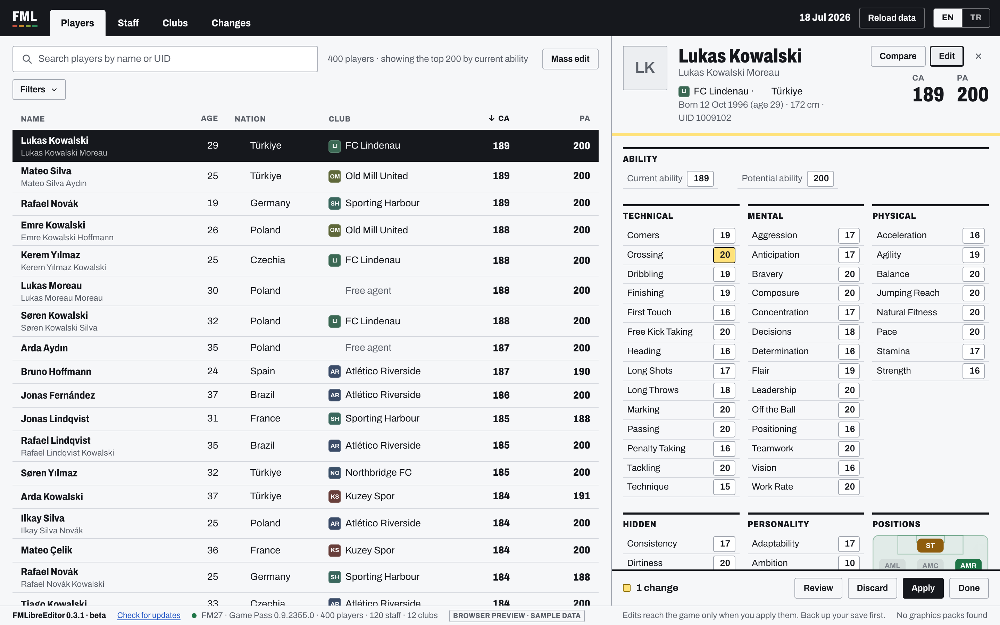

# FMLibreEditor

A free, open-source live editor for **Football Manager 27**. Edit players, staff and clubs
while the game runs.

Works on **Windows** (Xbox / Game Pass and Steam) and **macOS** (Steam).

## Download

- **Windows 10 or 11:**
  [FMLibreEditor-Setup.exe](https://github.com/tozmoz/FMLibreEditor/releases/latest/download/FMLibreEditor-Setup.exe)
  or the [portable zip](https://github.com/tozmoz/FMLibreEditor/releases/latest/download/FMLibreEditor-portable.zip)
- **macOS:**
  [FMLibreEditor-macOS.zip](https://github.com/tozmoz/FMLibreEditor/releases/latest/download/FMLibreEditor-macOS.zip)

How to install and use it: [docs/INSTALL.md](docs/INSTALL.md).

## What it does

- Browse, search and filter every player, member of staff and club.
- Edit attributes, abilities, positions, personality, contracts, reputation, finances and more.
- Heal injuries, lift bans, raise morale and fitness, set captains, for one player or a whole team.
- Transfer, swap or release players, and move staff between clubs.
- Mass edit many at once, with a preview; undo any change.
- English and Turkish; logos, flags and faces from your graphics packs.

The game shows a change once you press **Continue** in FM.

> **Status: beta.** Use it with offline, single-player saves, and back up your save
> before editing.

## For developers

How it works, building, releasing and the command-line probe:
[docs/DEVELOPING.md](docs/DEVELOPING.md).

FMLibreEditor is not affiliated with or endorsed by Sports Interactive or SEGA. Memory-layout
leads come from GPL-3.0 project:
[fm-editor](https://github.com/barak14/fm-editor) by barak14

## License

GPL-3.0-or-later. See [LICENSE](LICENSE). The app's typeface,
[Archivo](https://github.com/Omnibus-Type/Archivo) by Omnibus-Type, is bundled under the SIL
Open Font License 1.1 ([app/licenses/Archivo-OFL.txt](app/licenses/Archivo-OFL.txt)).
