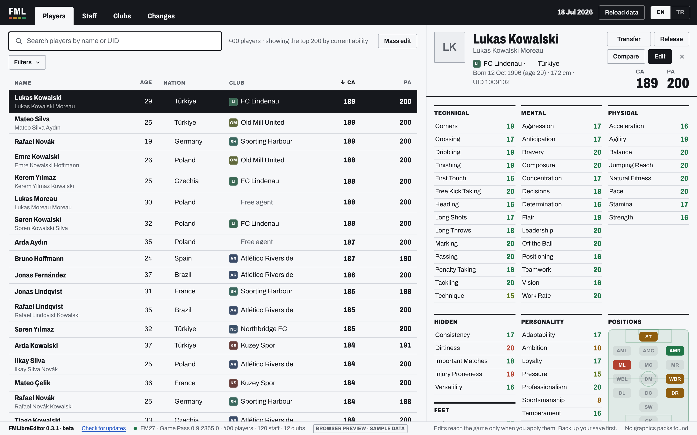

# What FMLibreEditor does

Everything the editor does, by what you want to do. A few of these need a check on each
version of the game: [COMPATIBILITY.md](COMPATIBILITY.md) lists which versions have them.
How to install the app and find your way around it: [INSTALL.md](INSTALL.md).

The game shows a change once you press **Continue** in FM.

## Browse and find

- Browse, search and filter every player, member of staff and club; clubs by nation, league
  and reputation.
- The app opens on **My club**: the club you manage, its money, who needs a look (the
  injured, the banned, low morale, the tired, unrest, contracts about to end) and the actions
  on the whole team one click away. With no club of your own, pick one to follow.
- A club's squad has a button for each of its teams, its B teams too (Real Madrid: First team,
  U19, Castilla, Real Madrid C), and the actions on a team work on each of them.
- **Ctrl+K** (**⌘K** on macOS) opens one search over players, staff, clubs and the app's
  commands. The tabs (Ctrl+1 to 7), the list's search (Ctrl+F), Edit (Ctrl+E), Apply (Ctrl+S)
  and Reload data (Ctrl+R) have shortcuts too, with ⌘ on macOS.
- See each nation's men's and women's national team in the Clubs tab (its **National teams**
  switch), with the players the game lists for its senior team. On Windows and Apple silicon
  Macs, its profile also shows, read only, the year its federation was founded, the nation's
  continent and the federation's staff, team by team, each with their job in the national team.
- Logos, flags and faces come from your graphics packs.

## Edit a player or a member of staff

- Attributes, abilities, positions, personality, traits, reputation and more.
- Contracts with their bonuses and clauses. One click extends a contract by five years.
- Rename a player: first, last, common and full name. The game keeps names in its saves, so a
  new name stays once you save.

## Fix things in one click

- Heal injuries, lift bans, remove unhappiness, prevent retirement, raise morale and fitness,
  max out attributes, set captains, for one player or a whole team.
- **Team at its best** heals, inspires and refreshes a whole team and takes its cohesion and
  tactic to the top in one press. **Destroy**, after a question, does the other way round.
  One Undo takes either back.
- **Batch traits** gives every player of a team the traits you pick, or takes them away.
- **Recipes**: ready-made sets of changes for one player or one club, each shown value by value
  before anything is written and taken back with one Undo. Make a wonderkid (21 or younger),
  Injury-proof and Extend his career for a player; Make the club rich and Top facilities for a
  club. A recipe only ever raises a value to what it gives: one that is better already stays.
- A national team's senior squad has Heal all, Inspire all and Refresh all too.

## Freeze

Freeze a player's attributes, energy and match sharpness, a whole team's from its squad tab,
or a club's money. While the app runs, they do not go down, and the app freezes them again
when you connect to that save another time.

## Transfers and staff moves

- Transfer, swap or release players, and sign free agents.
- Move staff between clubs in their own job or another (doctors, analysts and directors of
  football too), one by one or a club's whole staff at once, or sign staff who have no club.
- Arrange a transfer for the game to make on its next day (Windows, and Macs with Apple
  silicon): the game moves the player, pays the fee, and keeps the move in his career
  history, with this season's matches at his old club, as it does for its own transfers.
- Arrange a loan the same way (Windows, and Macs with Apple silicon): until the day you pick,
  with the share of his wage the other club pays, a monthly fee and, if you like, an option
  to buy, which that club may take up when the loan ends; the game makes the loan the next
  day, in a transfer window or out of one, and his history shows it, as it does for its own.

## Clubs, money and rules

- Edit a club's reputation and finances.
- Rename a stadium. The game takes stadium names from its database each time it loads a
  save, so the app gives the new name back whenever it does, while the app is open.
- See and change the prize money a club's league pays this season, by final position and per
  win, draw and loss, in the club's finances. The change is for every club in that league,
  until the game sets the next season up with its own amounts.
- See a club's sponsorship deals in its finances, read only: each deal by the name the game
  gives its kind, what it pays per season and in all, its term, and what a relegation changes.
- See and change a competition's squad rules in the Competitions tab: how many foreign
  players a squad may register, how many goalkeepers, how many players in all, and what a
  team may pick for a match, this season's and next season's apart. A change is kept in the
  save. UEFA's Champions, Europa and Conference League keep their rules in none, so the
  editor holds a change of them and writes it again each time it connects. Competitions the
  game gives no squad rules (Scotland's and Slovakia's top divisions, most cups) are listed
  too, and say so.
- Edit a national team's reputation.

## Follow a career

The app notes every player's abilities, value and attributes about once a week of the game's
time, whenever it reads the game. A profile's **Development** tab draws them over time and
lists the attributes that changed. A note under his abilities, arrows beside the attributes
and a club's squad say who gained and who lost over the last year.

## Mass edit, undo and export

- Mass edit many players or staff at once, with a preview. It adds years to many contracts at
  once too.
- Undo any change. The **Changes** view keeps the changes of each career.
- Export the player, staff or club list, with its search and filters, to CSV or JSON for a
  spreadsheet or your own tools: attributes, positions, personality, contracts, club finances
  and more, with the in-game date.

## Care with your save

- The app checks how it reads the game before it writes, and stays read-only on a version of
  FM27 it has not been checked with yet.
- It notices when the game loads a save or goes back to its main menu, and then changes
  nothing, freezes included, until you reload the data.

Even so: use it with offline, single-player saves, and back up your save before editing.

## Languages and updates

- English, Turkish, Spanish, German, French, Indonesian, Italian, Japanese, Korean, Brazilian
  Portuguese, Russian and Simplified Chinese.
- The app updates itself on Windows and macOS: one click downloads and installs a new
  version.
