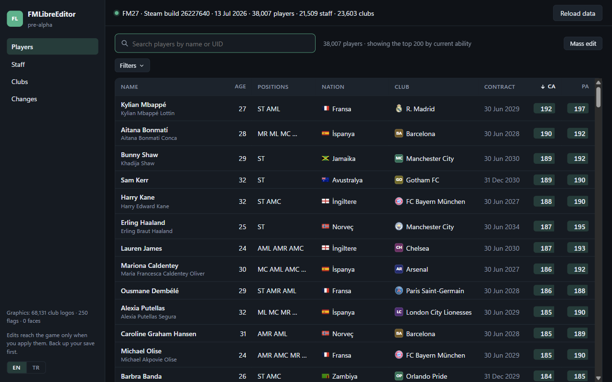

# FMLibreEditor: installing and using it

FMLibreEditor is a free program that edits the players, staff and clubs of Football Manager
27 while the game runs. It works on Windows 10 and 11 with both the **Xbox / Game Pass** and
the **Steam** build of the game.

*Türkçe: [KURULUM.md](KURULUM.md)*

## 1. Download

Click the link below and the download starts. No GitHub account is needed, and the link
always fetches the latest version.

### **[⬇ Download FMLibreEditor (FMLibreEditor-Setup.exe)](https://github.com/tozmoz/FMLibreEditor/releases/latest/download/FMLibreEditor-Setup.exe)**

If you would rather not install anything, download the portable version:
[FMLibreEditor-portable.zip](https://github.com/tozmoz/FMLibreEditor/releases/latest/download/FMLibreEditor-portable.zip).
Right-click the zip, choose **Extract All**, and run **FMLibreEditor.exe** from the folder.

## 2. Install

1. Double-click **FMLibreEditor-Setup.exe** in your Downloads folder.
2. Windows may show a blue window saying "**Windows protected your PC**". This is because
   the program is not digitally signed yet; it does not mean it is a virus. Click **More
   info**, then **Run anyway**.
3. Pick the installer's language, then press **Next** and **Install**.
   - No administrator rights are needed: the program installs for your user account only.
   - If your PC lacks WebView2, the installer adds it. Windows 10 and 11 usually have it
     already.
4. A **FMLibreEditor** shortcut appears in the Start menu.

## 3. Use it

1. Start **Football Manager 27** and **load a save**. The main menu is not enough: the
   game's database is ready only once a save is loaded.
2. Open **FMLibreEditor**. It finds the running game by itself; press **Connect**.
3. The player list opens. Search, filter and sort with the box at the top and **Filters**.
   Click a player to open his profile.
4. In a profile, press **Edit**, change values, see what will change with **Review**, and
   write it to the game with **Apply**.
5. Under **Clubs**, open a club and its **Squad** tab:
   - see the team's players with their energy, match sharpness and morale;
   - choose the captain;
   - change the whole team at once with **Heal all**, **Inspire all** and **Refresh all**.

## Good to know

- **Back up your save first.** The editor writes to the game's memory, and the changes go
  into your save file when you save in the game. Before trying it out, save your game under
  a new name in FM.
- **Changes show after Continue.** The game's screens show a copy of the data and refresh
  it as the game moves on. A change is in memory at once, but the screens show it after you
  press **Continue** once.
- **Everything can be undone.** The **Changes** view lists everything you did, and **Undo**
  writes the old value back. Team-wide actions are undone in one go.
- **Antivirus warnings.** Tools that read and write another program's memory, such as FMRTE
  and Cheat Engine, are sometimes flagged by mistake. FMLibreEditor is open source: anyone
  can read its code in this repository. If yours warns you, you can add the program to
  your antivirus's allow list.

## Updating and removing

- **To update**, use the download link above again and install. The new version installs
  over the old one.
- **To remove it:** Windows Settings → Apps → FMLibreEditor → Uninstall.

## Questions

- **It says Football Manager 27 is not running.** Start the game, load a save and try again.
- **It says the player list was not found.** The game is at its main menu; load a save.
- **It opened read-only.** Windows did not let it write to the game. Close it and open it
  again; if that does not help, right-click it and choose **Run as administrator**.
- **Which builds are supported?** FM27 on Windows, from Xbox / Game Pass and from Steam.
  Epic and Mac are not supported yet.
- **Does it cost anything?** No. FMLibreEditor is free and open source (GNU GPL, version 3
  or later).
