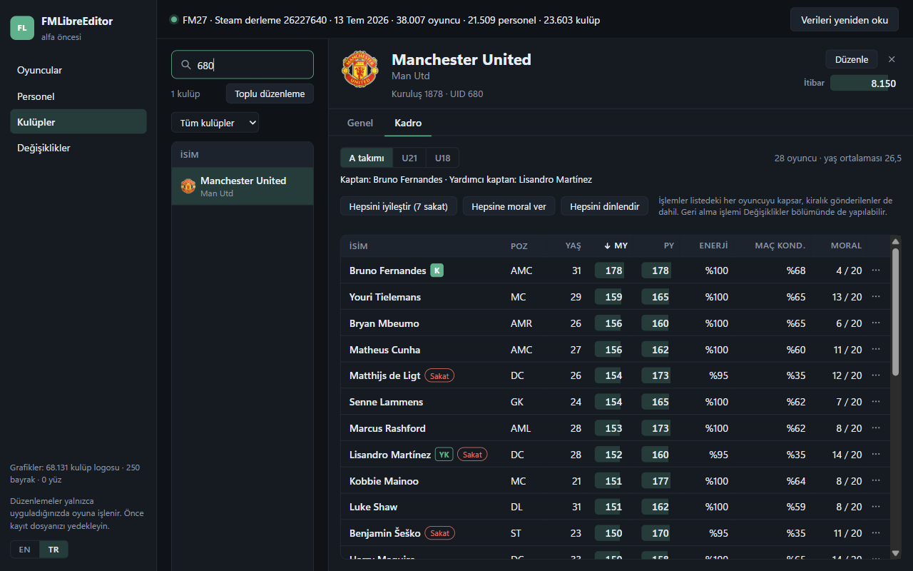

# FMLibreEditor: kurulum ve kullanım

FMLibreEditor, Football Manager 27 açıkken oyuncuları, personeli ve kulüpleri anında
düzenlemenizi sağlayan ücretsiz bir programdır. Windows 10 ve 11'de, oyunun **Xbox / Game
Pass** ve **Steam** sürümleriyle çalışır.

*English: [INSTALL.md](INSTALL.md)*

## 1. İndirin

Aşağıdaki bağlantıya tıklayın; indirme hemen başlar. GitHub hesabı gerekmez, bağlantı her
zaman en son sürümü indirir.

### **[⬇ FMLibreEditor'ı indir (FMLibreEditor-Setup.exe)](https://github.com/tozmoz/FMLibreEditor/releases/latest/download/FMLibreEditor-Setup.exe)**

Kurulum yapmak istemiyorsanız taşınabilir sürümü indirin:
[FMLibreEditor-portable.zip](https://github.com/tozmoz/FMLibreEditor/releases/latest/download/FMLibreEditor-portable.zip).
Zip'e sağ tıklayıp **Tümünü ayıkla** deyin ve klasördeki **FMLibreEditor.exe**'yi
çalıştırın.

## 2. Kurun

1. İndirilenler klasörünüzdeki **FMLibreEditor-Setup.exe**'ye çift tıklayın.
2. Windows mavi bir pencerede "**Windows kişisel bilgisayarınızı korudu**" diyebilir. Bunun
   sebebi programın henüz dijital olarak imzalanmamış olmasıdır; virüs olduğu anlamına
   gelmez. **Ek bilgi**'ye, ardından **Yine de çalıştır**'a tıklayın.
3. Kurulum dilini seçin, sonra **İleri** ve **Yükle**'ye basın.
   - Yönetici izni gerekmez; program yalnızca sizin kullanıcı hesabınıza kurulur.
   - Bilgisayarınızda WebView2 yoksa kurulum onu da kurar. Windows 10 ve 11'de genellikle
     zaten vardır.
4. Başlat menüsünde **FMLibreEditor** kısayolu oluşur.

## 3. Kullanın

1. **Football Manager 27**'yi açın ve bir **kayıt yükleyin**. Ana menü yetmez: oyunun
   veritabanı ancak bir kayıt yüklenince hazır olur.
2. **FMLibreEditor**'ı açın. Program çalışan oyunu kendisi bulur; **Bağlan** düğmesine
   basın.
3. Oyuncular listesi açılır. Aramak, süzmek ve sıralamak için üstteki kutuyu ve
   **Filtreler**'i kullanın. Bir oyuncuya tıklayınca profili açılır.
4. Profilde **Düzenle**'ye basın, değerleri değiştirin, **Gözden geçir** ile neyin
   değişeceğini görün ve **Uygula** ile oyuna yazın.
5. **Kulüpler** bölümünde bir kulübü açıp **Kadro** sekmesine geçin:
   - takımın oyuncularını, enerjilerini, maç kondisyonlarını ve morallerini görürsünüz;
   - kaptanı seçebilirsiniz;
   - **Hepsini iyileştir**, **Hepsine moral ver** ve **Hepsini dinlendir** ile bütün takımı
     bir kerede düzenleyebilirsiniz.

## Bilmeniz gerekenler

- **Önce kaydınızı yedekleyin.** Düzenleyici oyunun belleğine yazar; değişiklikler, oyunda
  kaydettiğinizde kayıt dosyasına geçer. Denemeden önce oyunda kaydınızı farklı bir adla
  kaydedin.
- **Değişiklikler Devam'dan sonra görünür.** Oyunun ekranları verinin bir kopyasını
  gösterir ve bu kopyayı oyun ilerleyince tazeler. Değişiklik bellekte hemen olur ama
  ekranda oyunda bir kez **Devam**'a bastıktan sonra görünür.
- **Her şey geri alınabilir.** **Değişiklikler** bölümü yaptığınız her şeyi listeler;
  **Geri al** eski değeri geri yazar. Toplu işlemler tek seferde geri alınır.
- **Antivirüs uyarısı.** Başka bir programın belleğini okuyup yazan araçlar (FMRTE ve Cheat
  Engine gibi) bazen antivirüslerce yanlışlıkla işaretlenir. FMLibreEditor açık kaynaktır;
  kodunu bu depoda herkes inceleyebilir. Uyarı alırsanız programı antivirüsünüzün izin
  listesine ekleyebilirsiniz.

## Güncelleme ve kaldırma

- **Güncellemek için** yukarıdaki indirme bağlantısını yeniden kullanıp kurun; yeni sürüm
  eskisinin üzerine kurulur.
- **Kaldırmak için:** Windows Ayarlar → Uygulamalar → FMLibreEditor → Kaldır.

## Sık sorulanlar

- **"Football Manager 27 çalışmıyor" diyor.** Oyunu açıp bir kayıt yükleyin ve tekrar
  deneyin.
- **"Oyuncu listesi bulunamadı" diyor.** Oyun ana menüde; bir kayıt yükleyin.
- **Program yalnızca okuma modunda açıldı.** Windows oyuna yazmaya izin vermemiş. Programı
  kapatıp yeniden açın; olmazsa sağ tıklayıp **Yönetici olarak çalıştır** deyin.
- **Hangi sürümler destekleniyor?** FM27'nin Windows'taki Xbox / Game Pass ve Steam
  sürümleri. Epic ve Mac henüz desteklenmiyor.
- **Ücretli mi?** Hayır. FMLibreEditor ücretsiz ve açık kaynaklıdır (GNU GPL, sürüm 3 ya da
  sonrası).
